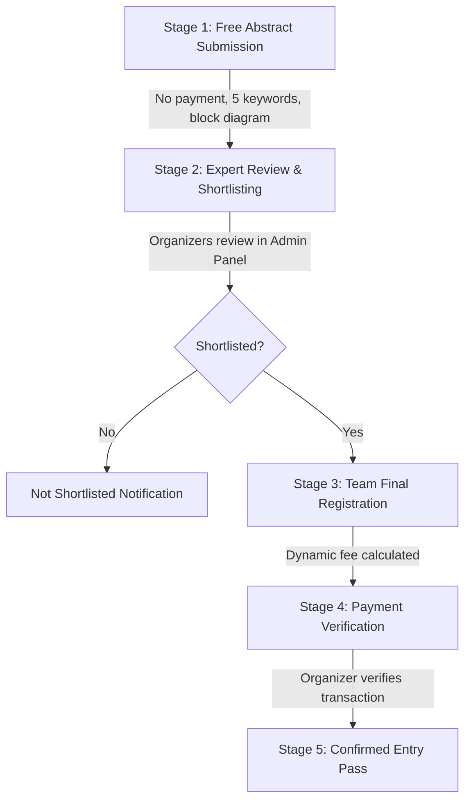

# TEKZITHON 2027 — 36-Hour Hardware Hackathon Platform

> **Hosted by St. Peter’s Engineering College**  
> *UGC - Autonomous · NBA & NAAC 'A' Grade Accredited*  
> **Event Date:** 22 January 2027  
> **Tagline:** *Build. Innovate. Prototype. Solve Real-World Problems.*

---

## 1. Project Overview & Deliverables

This repository contains the complete production-grade web infrastructure for **TEKZITHON 2027**, featuring a single-file public website (`index.html`), a dedicated Google Apps Script backend (`Code.gs`), an administrative management suite (`admin.html`), and the official college branding assets.

### File Manifest

| File | Type | Description |
|---|---|---|
| [`index.html`](file:///c:/Users/Admin/Downloads/GIS/index.html) | Public Frontend | Standalone single-file frontend (HTML5, CSS3, Vanilla JS, Three.js via CDN). Contains the 3D Gift Box interaction, live countdown, 10 project domains, 5-stage workflow, abstract submission form, and shortlist lookup. |
| [`admin.html`](file:///c:/Users/Admin/Downloads/GIS/admin.html) | Admin Suite | Protected admin dashboard for abstract evaluation, shortlisting, registration approval, dynamic fee monitoring, domain CRUD, and resource management. |
| [`Code.gs`](file:///c:/Users/Admin/Downloads/GIS/Code.gs) | Backend | Google Apps Script handling Google Sheets database tabs, Google Drive file storage, token authentication, and email receipts. |
| [`logo.png`](file:///c:/Users/Admin/Downloads/GIS/logo.png) | Asset | Official St. Peter's Engineering College horizontal banner logo (`1992x390`), preserving original colors, lettering, and accreditation badges. |
| [`logo-white.png`](file:///c:/Users/Admin/Downloads/GIS/logo-white.png) | Asset | High-resolution white-text variation of the college banner. |
| [`spec-logo.png`](file:///c:/Users/Admin/Downloads/GIS/spec-logo.png) | Asset | High-resolution institutional insignia (`4164x2628`). |

---

## 2. Signature Interactive 3D Gift Box

The highlight of the platform is an eye-catching, interactive 3D gift-box experience that introduces the free abstract submission benefit.

### Visual & Interactive Features
- **3D Modeling (Three.js WebGL)**: Dark metallic midnight navy body (`#071126`), contrasting cyan (`#22d3ee`) and violet (`#8b5cf6`) ribbon bands, 3D curved bow loops, and glowing neon edge lines.
- **Pointer & Touch Tracking**: Smooth lerp tilt tracking mouse cursor coordinates on desktop and touch gestures on mobile devices.
- **Gentle Idle State**: Gentle harmonic floating bobbing and 260 ambient swirling sparkle particles.
- **Accessible Trigger**: Accessible **“OPEN YOUR GIFT”** button alongside direct canvas click/tap with full keyboard accessibility (`Enter`/`Space`).
- **Opening Animation Sequence**:
  1. *Anticipation Squash & Bounce*: Box squashes and rebounds upward with spring physics.
  2. *Hinged Lid Rotation*: Lid rotates open backwards -122 degrees on its back pivot axis, intensifying the cyan interior point light from 0 to 5.0 intensity.
  3. *Particle Fountain Eruption*: 260 vibrant cyan, violet, and gold particles burst vertically upward with simulated velocity and gravity.
  4. *Luminous Emergent Card*: Luminous glassmorphic card floats up revealing:
     - **🎁 ABSTRACT SUBMISSION IS FREE!**
     - *“Submit your innovative hardware project abstract at absolutely no cost. Get your idea reviewed by the TEKZITHON organizing team.”*
     - *“No payment required at the abstract submission stage.”*
     - Direct CTA: **“SUBMIT YOUR ABSTRACT”** (smoothly scrolls to the submission form).
  5. *Replay Support*: Click **“🔄 Replay Gift Animation”** to close the lid, reset particle orbits, and replay the reveal.
- **Fallback**: Graceful CSS 3D fallback if WebGL is disabled or Three.js CDN is unreachable.

---

## 3. Verified Event Details & 5-Stage Workflow

The platform strictly adheres to verified hackathon parameters:

- **Event Name**: TEKZITHON 2027
- **Event Type**: 36-Hour Hardware Hackathon
- **Event Date**: 22 January 2027
- **Abstract Submission Deadline**: 15 December 2026 (23:59 IST)
- **Expected Shortlist Announcement**: 26 December 2026
- **Participation Fee**: ₹399 per participant (payable only after shortlisting)
- **Team Size**: 1 to 4 participants (including Team Leader)
- **Official Contact Email**: `hod.ece@stpetershyd.com`

### Sequence of Stages


1. **Stage 1 — Free Abstract Submission**: Any eligible student team submits project title, domain, single 500-word abstract, 5 distinct keywords, and block diagram image. Saves record to Sheets, uploads diagram to private Drive, and assigns a unique `TKZ27-XXXXXX` reference code. **Zero payment required.**
2. **Stage 2 — Shortlisting**: Technical review committee reviews abstracts in `admin.html`. Statuses: `Pending Review`, `Shortlisted`, `Not Shortlisted`.
3. **Stage 3 — Final Team Registration**: Only shortlisted teams unlock this form. Collects full team roster (1 to 4 members).
4. **Stage 4 — Dynamic Payment**: ₹399 charged per confirmed participant:
   - 1 Member: ₹399
   - 2 Members: ₹798
   - 3 Members: ₹1,197
   - 4 Members: ₹1,596  
   *(Never displays ₹1,600 as a fixed fee)*. Payment instructions are revealed **only after shortlisting**.
5. **Stage 5 — Confirmation**: Organizer verifies payment and marks registration as `Confirmed`.

---

## 4. Google Sheets & Google Apps Script Setup

### Step 1: Create Spreadsheet
1. Open [Google Sheets](https://sheets.new) and create a sheet named `TEKZITHON 2027 Database`.
2. Go to **Extensions > Apps Script**.
3. Clear default code and paste the complete contents of [`Code.gs`](file:///c:/Users/Admin/Downloads/GIS/Code.gs).
4. Click **Save** (disk icon).

### Step 2: Initialize Database & Drive Folder
1. In the Apps Script toolbar, select the **`setup`** function from the dropdown.
2. Click **Run**.
3. Authorize permissions when prompted (Google Sheets, Drive, MailApp).
4. `setup()` automatically builds 8 formatted sheets:
   - `Config` (Default dates, fee settings, toggle flags)
   - `Domains` (Populated with all 10 default domains)
   - `Abstracts` (Stores team submissions, file IDs, and review notes)
   - `Registrations` (Stores final team rosters, calculated fees, and payment status)
   - `Resources` (Event brochures, rulebooks, schedules)
   - `Leaderboard` (Scores, team rankings, achievement tags)
   - `Announcements` (Live updates and timeline alerts)
   - `AuditLog` (Admin action trail with timestamps)
5. `setup()` creates a private Google Drive folder named `TEKZITHON 2027 — Private Submissions` and records its ID in Script Properties.

### Step 3: Configure Admin Security
1. In Apps Script, click **Project Settings** (gear icon on left).
2. Under **Script Properties**, click **Add script property**:
   - **Property**: `ADMIN_PASSWORD`
   - **Value**: Set a strong, unique administrative password (e.g. `TekziAdmin2027#Secure`).
3. Click **Save script properties**.

### Step 4: Deploy Web App
1. Click **Deploy > New deployment**.
2. Select type: **Web app**.
3. Configuration:
   - **Description**: `TEKZITHON 2027 Production Backend`
   - **Execute as**: `Me (your Google account)`
   - **Who has access**: `Anyone` *(required for public student submissions without Google login)*
4. Click **Deploy**.
5. Copy the resulting **Web app URL** (ends in `/exec`).

---

## 5. Connecting Frontend & Admin Suite

### Connect `index.html`
1. Open [`index.html`](file:///c:/Users/Admin/Downloads/GIS/index.html) in your editor.
2. Locate line 849:
   ```javascript
   const API_URL = '';
   ```
3. Insert your deployed Apps Script URL:
   ```javascript
   const API_URL = 'https://script.google.com/macros/s/AKfycb.../exec';
   ```
4. Save the file.

### Connect `admin.html`
1. Open [`admin.html`](file:///c:/Users/Admin/Downloads/GIS/admin.html) in your editor.
2. Locate line 74:
   ```javascript
   const API_URL = '';
   ```
3. Insert the exact same Apps Script URL:
   ```javascript
   const API_URL = 'https://script.google.com/macros/s/AKfycb.../exec';
   ```
4. Save the file.

---

## 6. Admin Panel Operations Guide

Access `admin.html` in your browser and log in using the `ADMIN_PASSWORD` you configured.

- **Dashboard**: Live tally of total abstracts, pending reviews, shortlisted teams, confirmed registrations, and verified revenue.
- **Abstracts Review**:
  - Filter by status (`Pending Review`, `Shortlisted`, `Not Shortlisted`) or search by team/title.
  - View full 500-word abstract, 5 keywords, and inspect the uploaded block diagram image in-modal.
  - Download optional PDF if attached.
  - Set status to **Shortlisted** or **Not Shortlisted** and attach internal evaluation notes.
  - Export submissions to CSV.
- **Registrations & Payments**:
  - View verified team rosters, participant breakdown, and dynamic amount due.
  - Input bank/UPI reference numbers.
  - Click **Mark payment verified** to update payment status to `Paid`.
  - Click **Confirm registration** to issue official hackathon clearance.
- **Domains Management**:
  - Edit default domains or add additional categories.
  - Toggle active status and adjust display order.
- **Settings**:
  - Adjust countdown target timestamp (ISO 8601).
  - Configure timer mode (`published`, `paused`, `hidden`).
  - Set official payment instructions (UPI ID, account details, QR notes) — **these instructions are only shown to shortlisted teams**.

---

## 7. Organizing Committee Directory

Presented in dedicated cards with clickable `tel:` links and one-click copy helpers:

### Student Coordinators
- **Ch. Satya Swaroopa Nissi** — [+91 9014226245](tel:+919014226245)
- **M. Srinivas** — [+91 9381320342](tel:+919381320342)
- **N. Akash** — [+91 6304429910](tel:+916304429910)
- **Rani Kumari** — [+91 7013135534](tel:+917013135534)

### Faculty Coordinators
- **Ms. S. Swetha**
- **Mr. M. Ranjeeth Reddy**
- **Mr. B. Sravan Kumar**

### Event Leadership
- **Convener:** Dr. K. Prasana Kumar
- **Co-Convener:** Dr. Ch. Sai Teja

### Official Contact
- **Email:** [`hod.ece@stpetershyd.com`](mailto:hod.ece@stpetershyd.com)

---

## 8. Verification & Testing Checklist

| Test Item | Expected Result | Verified |
|---|---|:---:|
| **Official Logo** | Positioned horizontally centered at top; original colors and accreditation badges preserved. | [x] |
| **Countdown Timer** | Accurately calculates days, hours, mins, secs to 22 Jan 2027 (Asia/Kolkata). | [x] |
| **Gift Box Interaction** | Hover/drag tilts box; click/Enter triggers squash bounce, lid opens -122°, particle fountain erupts, and card reveals free submission benefit. | [x] |
| **Replay Button** | Smoothly closes lid, resets particles, and allows reopening. | [x] |
| **Abstract Form Validation** | Requires Team Name, Leader Email, Project Title, Domain, 20–500 word abstract, and exactly 5 distinct keywords. | [x] |
| **Diagram Upload** | Validates PNG/JPG/JPEG under 5 MB; renders client-side thumbnail preview; provides remove button. | [x] |
| **Zero-Cost Submission** | Generates `TKZ27-XXXXXX` reference code; confirms `Pending Review` status; requires zero payment. | [x] |
| **Shortlist Verification Gate** | Unlocks final registration **only** when reference code is marked `Shortlisted` by organizer. | [x] |
| **Dynamic Fee Calculation** | Calculates ₹399 × confirmed participants (₹399, ₹798, ₹1,197, or ₹1,596). Never defaults to ₹1,600. | [x] |
| **Payment Instructions Privacy** | Payment instructions remain completely hidden from general public and unshortlisted teams. | [x] |
| **Admin Authentication** | Constant-time password validation on Apps Script server; protected token sessions; rate-limited. | [x] |
| **Responsive Mobile Layout** | Navigation drawer, 3D canvas, grid cards, and tables resize cleanly across phone, tablet, and desktop. | [x] |
